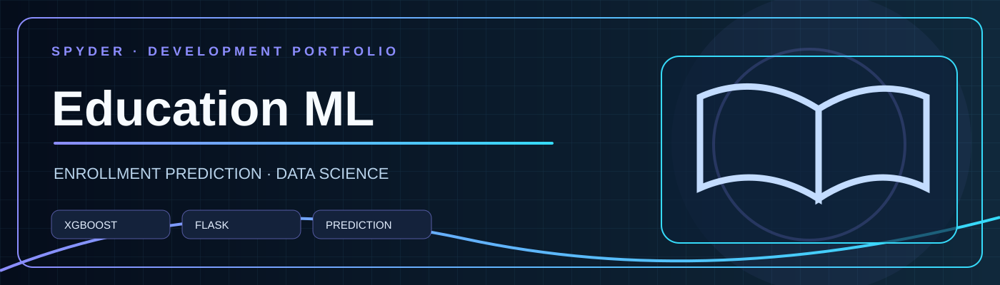

# Education ML — Enrollment Prediction

Flask interface for exploring machine-learning-based predictions from school and demographic indicators.

## Current project contents

- `ML MODELS FLASK BASED APPS - EDUCATION/app.py`: Flask routes accepting 15 numeric features.
- `load_model.py`: model and scaler initialization.
- `templates/`: form and result pages.
- `best_model.pkl` and `data_scaler.pkl`: existing serialized artifacts.

## Important compatibility issue

The current loader explicitly expects `best_model.json`, but only `best_model.pkl` is present in the repository. **Consequently a clean checkout cannot load the model as written.** The correct serialization format and model type must be determined before changing the loader.

## Setup (dependency installation)

```bash
python -m pip install -r requirements.txt
```

The app should only be run after fixing the model-file mismatch. Do not load serialized Python artifacts from untrusted sources.

## Validation status

Flask template and code files are present, but prediction accuracy, serialized model compatibility, and end-to-end execution are not verified. No production readiness is claimed.

## Maintainer

Abhinav Saini · GitHub: spyderabhi

## License

See `LICENSE`.
